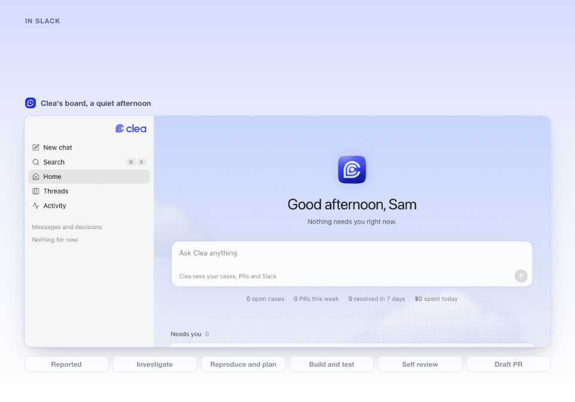
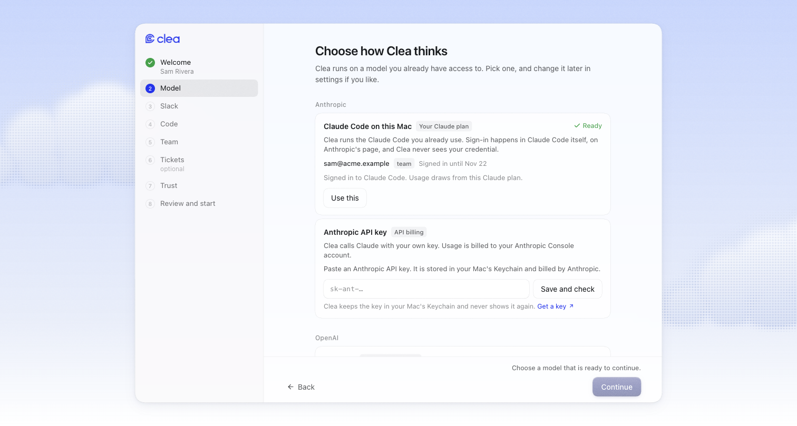
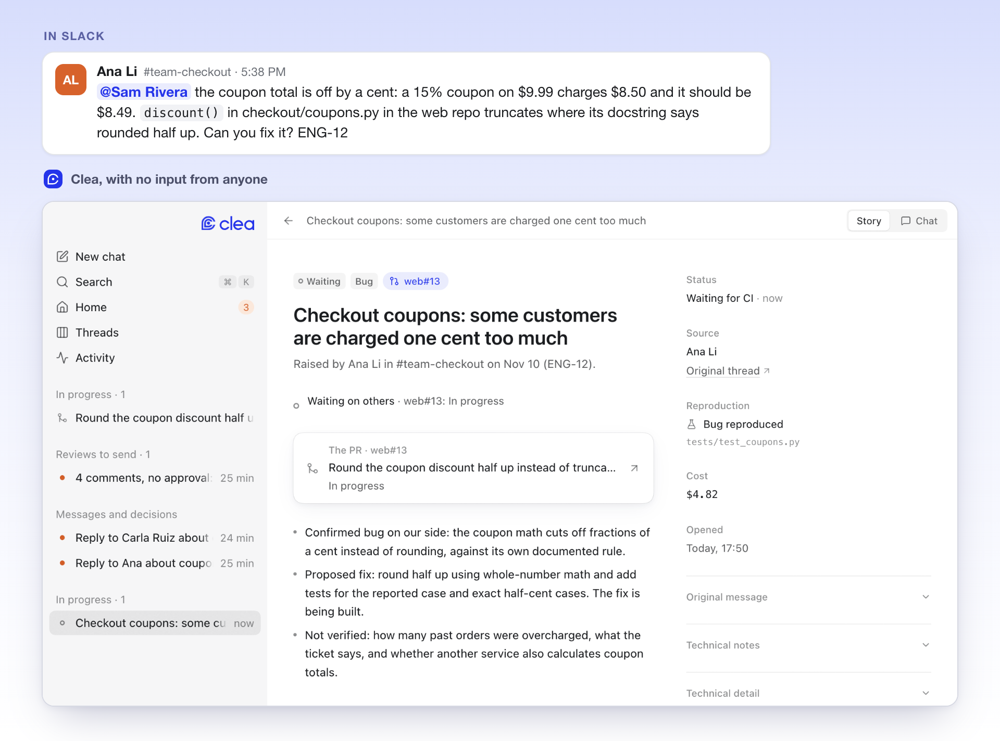
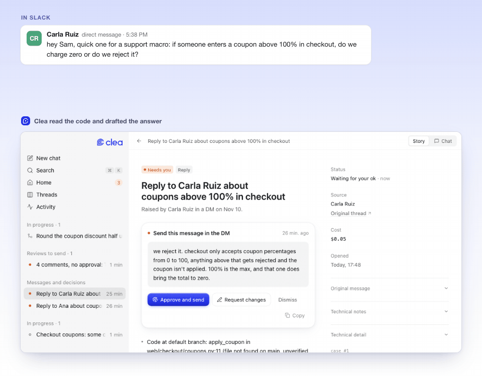
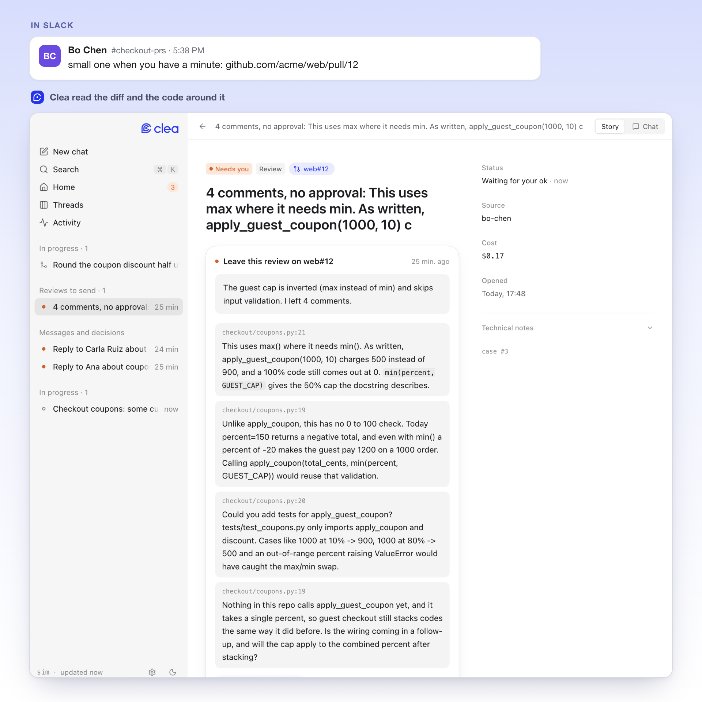
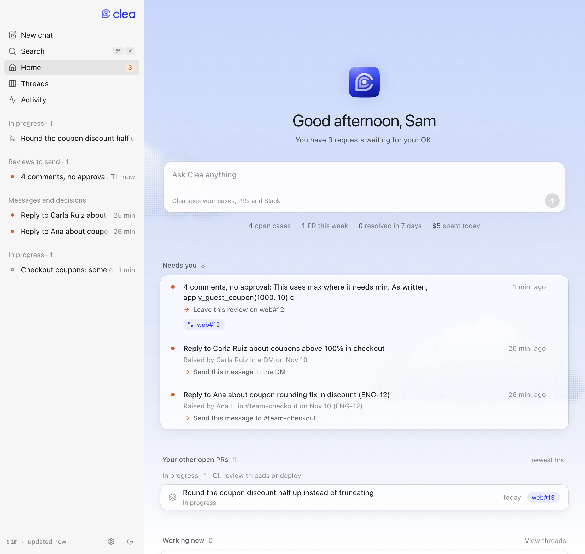
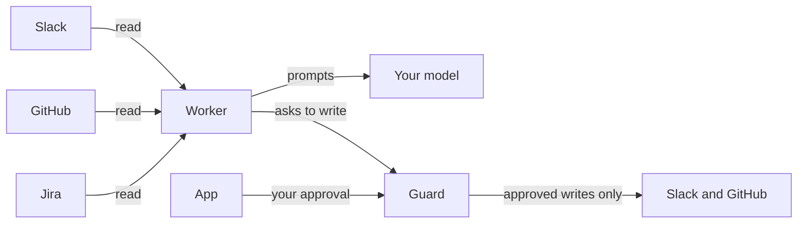

<p align="center">
  <picture>
    <source srcset=".github/assets/logo-dark.svg" media="(prefers-color-scheme: dark)">
    <source srcset=".github/assets/logo-light.svg" media="(prefers-color-scheme: light)">
    
  </picture>
</p>

<p align="center">
  <strong>The open-source engineering agent that works your Slack, GitHub and Jira, on your Mac.</strong><br/>
  Someone reports a bug in a thread. Clea reads it, finds the cause, fixes it, tests it<br/>
  and opens a draft pull request. Nothing leaves in your name without your approval.
</p>

<p align="center">
  <a href="https://github.com/joaquingit1/clea/actions/workflows/ci.yml"></a>
  <a href="https://github.com/joaquingit1/clea/releases/latest"></a>
  <a href="LICENSE"></a>
  
</p>

<p align="center">
  <a href="#quickstart">Quickstart</a> ·
  <a href="#see-it-work">See it work</a> ·
  <a href="docs/how-it-works.md">How it works</a> ·
  <a href="docs/safety.md">Safety</a> ·
  <a href="docs/setup.md">Setup</a> ·
  <a href="docs/simulator.md">Simulator</a>
</p>

<p align="center">
  
</p>

<p align="center"><sub>
  A real run, not a mock-up: the real engine and a real model on a simulated workspace. Sixteen minutes, shown in twenty seconds.
  Run it yourself with <code>python -m sim -k demo --live --serve</code>.
</sub></p>

---

## Quickstart

**Download the app.** Get `Clea-0.2.2-arm64.dmg` from the [latest release](https://github.com/joaquingit1/clea/releases/latest),
drag Clea to Applications and open it. The engine and its own Python are inside: there is nothing else to install.
The first run walks you through connecting your model, Slack, repositories and team, in the app's own window.

It needs an Apple Silicon Mac, `git`, and the GitHub CLI signed in (`gh auth login`).

> [!NOTE]
> The download is not notarized by Apple yet, so macOS stops it the first time. Open it once, then go to
> System Settings, Privacy & Security, and choose **Open Anyway**. [docs/setup.md](docs/setup.md#the-first-time-you-open-it) has the details.

**Or run it from source** (Python 3.12+, Node 22+):

```
git clone https://github.com/joaquingit1/clea && cd clea
make install
make run
```

**No accounts at hand?** `make demo` opens the app on a simulated workspace, with no Slack, GitHub or model connected.

<p align="center">
  
</p>

## See it work

Most of an engineer's day is the work around the work: the question in a DM, the bug someone reports in a thread,
the pull request waiting for a review. Clea reads those where they happen and does them. These are real captures
from the simulated workspace that ships in this repo.

### A bug in a thread becomes a draft pull request

Ana reports a wrong total in `#team-checkout`. With no input from anyone, Clea confirms the bug in the code, writes a
test that fails because of it, fixes it in a worktree of its own, runs the repository's checks, reviews its own diff,
and opens a **draft** pull request. The reply to Ana waits for your OK.

<p align="center">
  
</p>

### A question gets an answer in your voice

Carla asks in a DM what checkout does with a coupon above 100%. Clea reads the code, drafts the answer the way you
write, and shows you what it checked and what it could not verify. You approve with Touch ID and exactly that text
is sent, as you.

<p align="center">
  
</p>

### A teammate's pull request gets a real review

Bo posts a pull request in the PR channel. Clea reads the diff and the code around it, verifies each finding before
keeping it, and prepares the review: here it caught an inverted cap that would have given every guest at least
50% off. The review is posted when you say so.

<p align="center">
  
</p>

### One place for what needs you

The board shows what is waiting for your decision, what Clea is working on right now, and where your pull requests
stand. Chatter, thank-yous and things that are not yours never show up.

<p align="center">
  
</p>

| When | Clea |
| --- | --- |
| Someone asks you something in Slack | Reads the thread, looks up what the answer needs in the code, drafts the reply in your voice |
| A teammate reports a bug | Reproduces it, fixes it, runs the repo's own checks, opens a draft pull request with the fix and its tests |
| A pull request is posted for review | Reads the diff and the code around it, verifies each finding, prepares the review |
| Your own pull request gets comments or red CI | Fixes, answers the reviewers, keeps it moving |
| A Jira ticket lands on you | Picks it up as work, the same way |
| It is chatter, a thank you, or not yours | Does nothing |

One conversation is one case: a thread, a DM or a ticket never turns into two pieces of work.

## You stay in control

> [!IMPORTANT]
> Clea runs as you: with your Slack token, your `gh` login and your repository's own tooling, on your Mac. It is a
> separation of duties inside your account, not a sandbox. Start at **Watch** or **Ask first**.

- **Every write goes through the guard**, a separate process with its own policy file. It verifies your approval
  itself (Touch ID in the app, or your reaction in your own Slack DM) and sends exactly the text you approved.
- **A message to another person is never sent without your OK**, at any trust level.
- **Pull requests open as drafts**, on branches Clea created, after the repository's checks pass. It never pushes to
  a default branch.
- **Nothing phones home.** No Clea server, no account, no telemetry. Your data goes to Slack, GitHub, Jira and the
  model you chose, with your own credentials. Tokens live in the macOS Keychain.

| | Watch | Ask first | Autonomous |
| --- | :---: | :---: | :---: |
| Drafts and reports, in your own DM | ✓ | ✓ | ✓ |
| Draft pull requests | | ✓ | ✓ |
| Messages to other people | | with your OK | with your OK |
| Reviews on teammates' pull requests | | with your OK | comments on its own |
| Merging its own approved, green pull requests | | with your OK | ✓ |

The full model is in [docs/safety.md](docs/safety.md).

## Bring your own model

Clea thinks with the account you already have. Pick one in the first run:

- **Claude Code on this Mac**, on your Claude plan
- **Anthropic API key**
- **Codex on this Mac** or **Sign in with ChatGPT**, on your ChatGPT plan
- **OpenAI API key**

## How it works



A worker reads and works in stages (triage, reproduce, investigate, plan, build, check, review). A guard decides
what may be written. An app on `127.0.0.1` shows the board, every case's evidence and the drafts waiting for you.
State is one SQLite file on your disk. More in [docs/how-it-works.md](docs/how-it-works.md).

## Tested against a simulated workspace

`make sim` runs the real engine against a simulated Slack and GitHub: 51 scenarios of what people write (bursts,
edits, threads answered by someone else, the same report in two channels, a draft approved, edited or declined) and
what must be true afterwards. `python -m sim --live` runs the same engine on your real model, including a seeded bug
that has to end as a draft pull request that fixes it. See [docs/simulator.md](docs/simulator.md).

## Status

Clea is pre-1.0 and macOS only. It has done one developer's daily work for months; this is its first release for
other teams. The download runs on Apple Silicon and is not notarized yet. Slack is the only messaging platform,
and GitHub the only code host.

## Contributing

Issues and pull requests are welcome. Start with [CONTRIBUTING.md](CONTRIBUTING.md); coding agents, read
[AGENTS.md](AGENTS.md). To report a vulnerability, see [SECURITY.md](SECURITY.md).

## License

[Apache 2.0](LICENSE) © 2026 Joaquin Castellano
