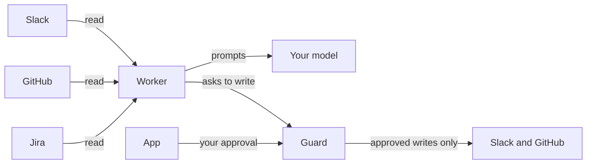

<p align="center">
  <picture>
    <source srcset=".github/assets/logo-dark.svg" media="(prefers-color-scheme: dark)">
    <source srcset=".github/assets/logo-light.svg" media="(prefers-color-scheme: light)">
    
  </picture>
</p>

<p align="center">
  <strong>The open-source engineering agent that works your Slack, GitHub and Jira, on your Mac.</strong><br/>
  It drafts your replies, investigates bugs, opens draft pull requests with the fix and its tests,<br/>
  and reviews your team's pull requests. Nothing leaves in your name without your approval.
</p>

<p align="center">
  <a href="https://github.com/joaquingit1/clea/actions/workflows/ci.yml"></a>
  <a href="https://github.com/joaquingit1/clea/releases/latest"></a>
  <a href="LICENSE"></a>
  
</p>

<p align="center">
  <a href="#quickstart">Quickstart</a> ·
  <a href="docs/how-it-works.md">How it works</a> ·
  <a href="docs/safety.md">Safety</a> ·
  <a href="docs/setup.md">Setup</a> ·
  <a href="docs/simulator.md">Simulator</a>
</p>

<p align="center">
  <picture>
    <source srcset=".github/assets/board-dark.png" media="(prefers-color-scheme: dark)">
    <source srcset=".github/assets/board-light.png" media="(prefers-color-scheme: light)">
    
  </picture>
</p>

---

## Quickstart

```
git clone https://github.com/joaquingit1/clea && cd clea
make install
make run
```

Open http://127.0.0.1:4848 and the first run walks you through connecting your model, Slack, repositories and team.
It needs macOS, Python 3.12+, Node 22+ and the GitHub CLI signed in. Details in [docs/setup.md](docs/setup.md).

**No accounts at hand?** `make demo` opens the app on a simulated workspace, with no Slack, GitHub or model connected.

## What Clea does

Most of an engineer's day is the work around the work: the question in a DM, the bug someone reports in a thread,
the pull request waiting for a review, the ticket nobody picked up. Clea reads those where they happen and does them.

| When | Clea |
| --- | --- |
| Someone asks you something in Slack | Reads the thread, looks up what the answer needs in the code, and drafts the reply in your voice |
| A teammate reports a bug | Reproduces it, finds the cause, plans, fixes it in a worktree, runs the repo's own checks, reviews its own diff, and opens a **draft pull request** with the fix and its tests |
| A pull request is posted for review | Reads the diff and the code around it, verifies each finding, and prepares the review |
| Your own pull request gets comments or red CI | Fixes, answers the reviewers, and keeps it moving |
| A Jira ticket lands on you | Picks it up as work, the same way |
| It is chatter, a thank you, or not yours | Does nothing |

One conversation is one case: a thread, a DM or a ticket never turns into two pieces of work.

<p align="center">
  <picture>
    <source srcset=".github/assets/case-dark.png" media="(prefers-color-scheme: dark)">
    <source srcset=".github/assets/case-light.png" media="(prefers-color-scheme: light)">
    
  </picture>
</p>

## You stay in control

> [!IMPORTANT]
> Clea runs as you: with your Slack token, your `gh` login and your repository's own tooling, on your Mac. It is a
> separation of duties inside your account, not a sandbox. Start at **Watch** or **Ask first**.

- **Every write goes through the guard**, a separate process with its own policy file. It verifies your approval
  itself (Touch ID in the app, or your reaction in your own Slack DM) and sends exactly the text you approved.
- **A message to another person is never sent without your OK**, at any trust level.
- **Pull requests open as drafts**, on branches Clea created, after the repository's checks pass. It never pushes to
  a default branch.
- **Nothing phones home.** No Clea server, no account, no telemetry. Your data goes to Slack, GitHub, Jira and the
  model you chose, with your own credentials. Tokens live in the macOS Keychain.

| | Watch | Ask first | Autonomous |
| --- | :---: | :---: | :---: |
| Drafts and reports, in your own DM | ✓ | ✓ | ✓ |
| Draft pull requests | | ✓ | ✓ |
| Messages to other people | | with your OK | with your OK |
| Reviews on teammates' pull requests | | with your OK | comments on its own |
| Merging its own approved, green pull requests | | with your OK | ✓ |

The full model is in [docs/safety.md](docs/safety.md).

## Bring your own model

Clea thinks with the account you already have. Pick one in the first run:

- **Claude Code on this Mac**, on your Claude plan
- **Anthropic API key**
- **Codex on this Mac** or **Sign in with ChatGPT**, on your ChatGPT plan
- **OpenAI API key**

## How it works



A worker reads and works in stages (triage, investigate, plan, build, check, review). A guard decides what may be
written. An app on `127.0.0.1` shows the board, every case's evidence and the drafts waiting for you. State is one
SQLite file on your disk. More in [docs/how-it-works.md](docs/how-it-works.md).

## Tested against a simulated workspace

`make sim` runs the real engine against a simulated Slack and GitHub: 51 scenarios of what people write (bursts,
edits, threads answered by someone else, the same report in two channels, a draft approved, edited or declined) and
what must be true afterwards. `python -m sim --live` runs the same engine on your real model, including a seeded bug
that has to end as a draft pull request that fixes it. See [docs/simulator.md](docs/simulator.md).

## Status

Clea is pre-1.0 and macOS only. It has done one developer's daily work for months; this is its first release for
other teams. Run it from a checkout for now: a signed download is not available yet. Slack is the only messaging
platform, and GitHub the only code host.

## Contributing

Issues and pull requests are welcome. Start with [CONTRIBUTING.md](CONTRIBUTING.md); coding agents, read
[AGENTS.md](AGENTS.md). To report a vulnerability, see [SECURITY.md](SECURITY.md).

## License

[Apache 2.0](LICENSE) © 2026 Joaquin Castellano
