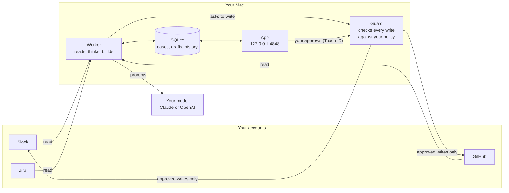

# How Clea works

Clea is two processes on your Mac and a database between them.

**The worker** (`ap/`) reads what you pointed it at, decides what is work, and does it in stages. It has no code that
posts a message, opens a pull request or merges: for each of those it asks the guard.

**The guard** (`guard/ap_guard.py`) is a separate process. The worker asks it over a local socket; the guard checks
each request against a policy file written by the setup, and for anything that needs you it checks your approval
itself. See [safety.md](safety.md).

**The app** (`ui/`, and `desktop/` for the native window) is the screen: the board of what Clea is doing, each
case's story and evidence, the drafts waiting for you, a chat, and Settings.

## From a message to a case

1. **Intake.** New Slack messages (Socket Mode, with polling as a fallback), pull requests and Jira tickets arrive as
   events. A zero-cost prefilter drops what asks nothing: acknowledgements, greetings, bots, channels you did not
   choose, your own messages.
2. **Triage.** What is left is classified: a reply someone is waiting on, a task, a pull request to review, or
   nothing. One conversation is one case: a thread, a DM or a ticket never opens a second case while the first is
   open, and the same report in two channels folds into one.
3. **A lane per kind of work**, each a sequence of stages that survive a restart:

| Lane | Stages | Ends with |
| --- | --- | --- |
| Reply | read the thread, look things up when the answer needs facts, draft, check the draft | A draft in your voice, waiting for your OK |
| Task | vet, reproduce, investigate, plan, critique the plan, build in a worktree, run the repo's own checks, self review, fix | A draft pull request with the fix and its tests |
| Review | read the diff and the code around it, find problems, verify each finding | A review waiting for your OK (or posted, if you allowed it) |
| Your own pull requests | watch CI and review threads, fix, answer reviewers | A green, answered pull request |
| Tickets | the Jira tickets you chose become tasks | The same as a task |

4. **The gate before a pull request.** Clea runs the repository's own checks (it detects Node, Python, Go, Rust and
   Makefile projects, or you name the commands) and compares failures with the base branch, so it never opens a pull
   request that breaks something that was passing, and is not blocked by a test that was already failing.
5. **Your decision.** Anything that would be read by another person waits on the board. You approve, edit or reject
   it in the app (Touch ID), or with a reaction in your own Slack DM.

## Where things live

| Path | What |
| --- | --- |
| `ap/` | The engine: intake, triage, lanes, gates, providers, the app's API |
| `guard/` | The guard and its Touch ID helper |
| `prompts/engine/` | The prompts every install starts from |
| `ui/` | The app (React, Tailwind) |
| `desktop/` | The native window (Electron), which starts and stops the engine |
| `sim/` | The simulator: the real engine against a simulated Slack and GitHub |
| `tests/` | Unit tests |
| `<CLEA_HOME>/` | One install: `config.json`, `var/` (database, logs), `guard/policy.json`, worktrees |

Tokens are never in `CLEA_HOME`: they live in the macOS Keychain.
